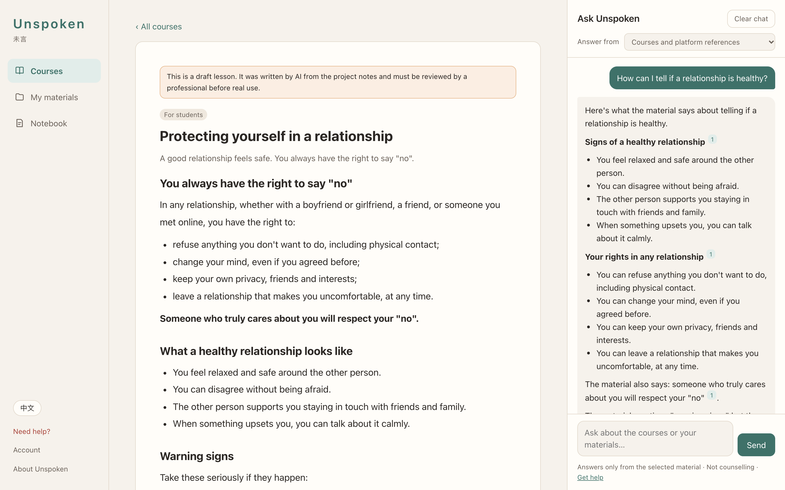
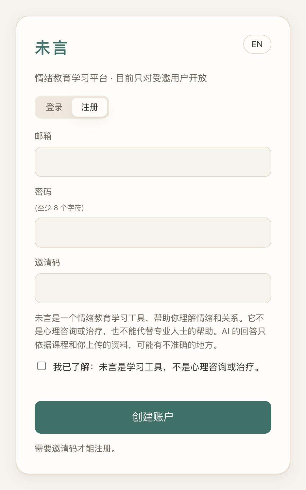
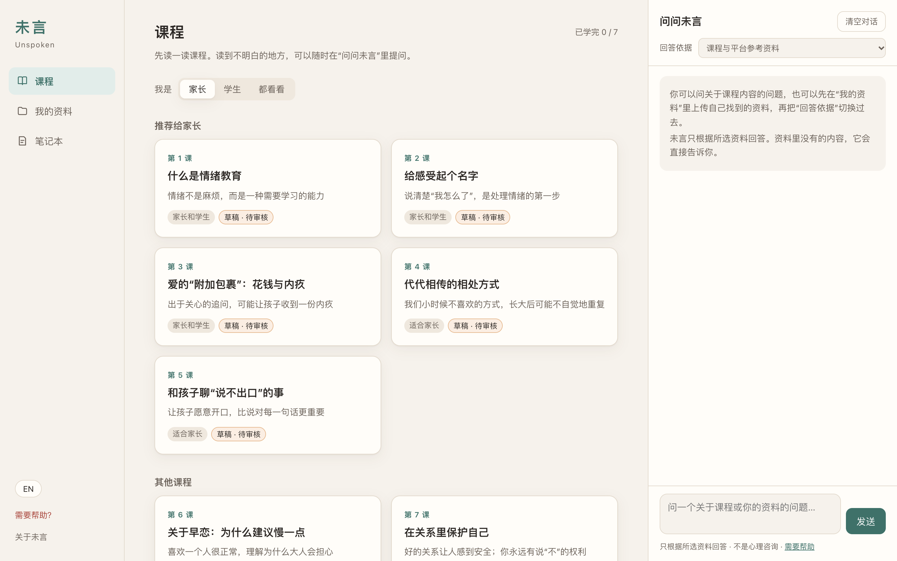
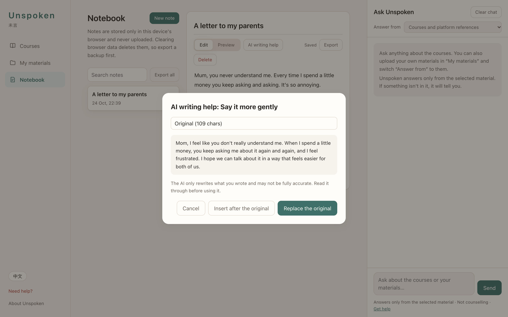
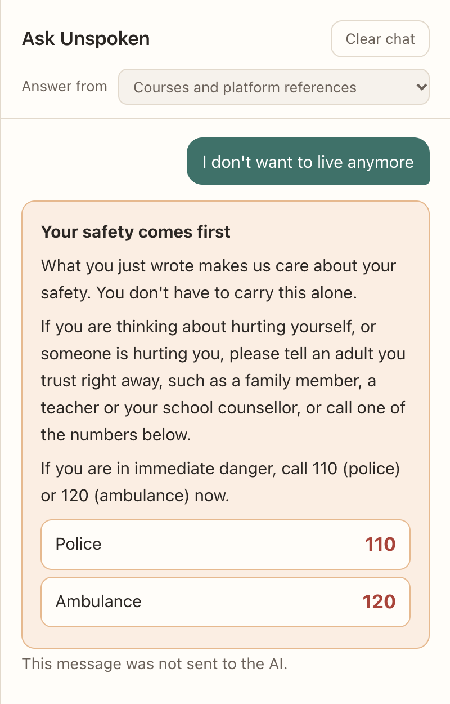
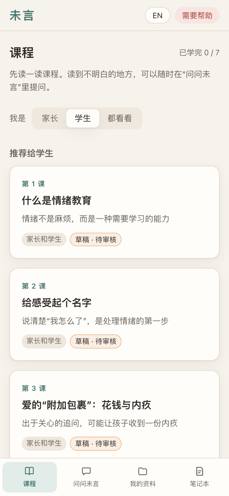
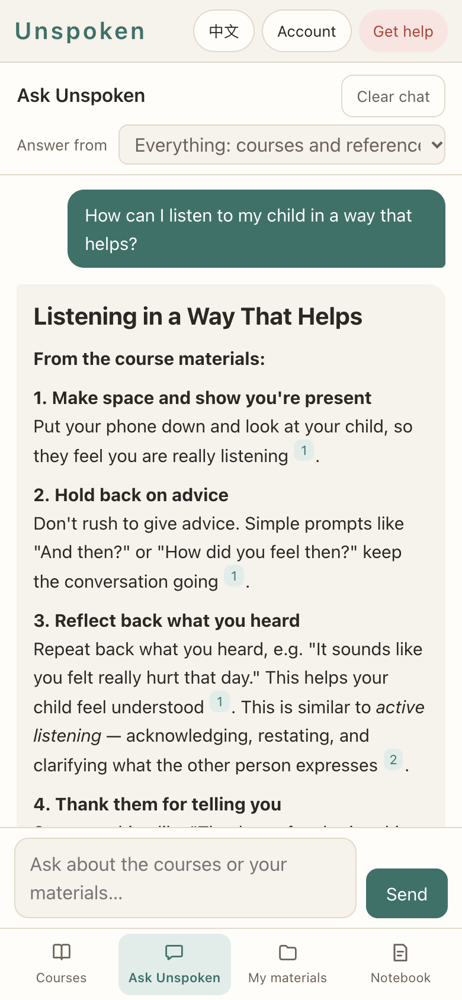
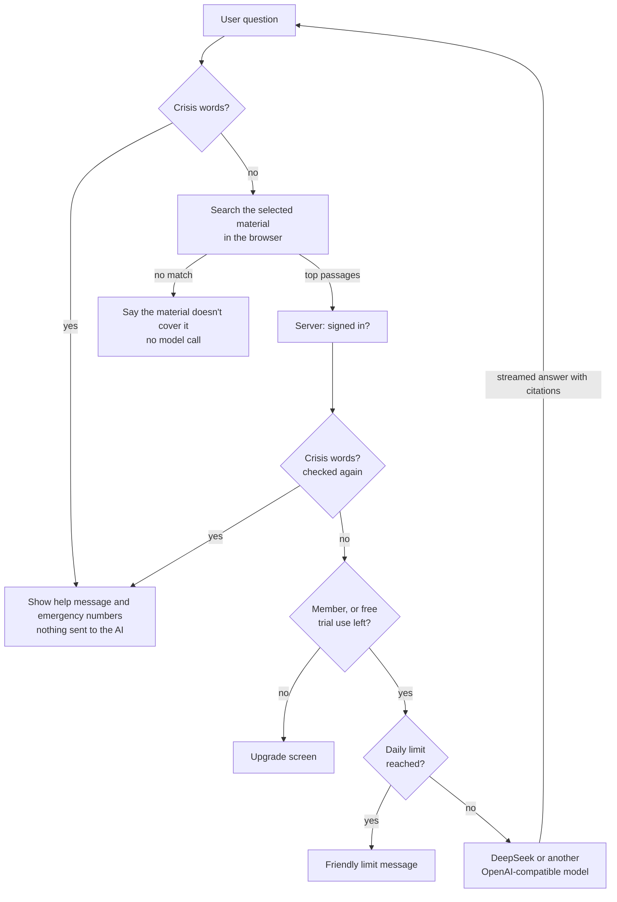

# Unspoken 未言

**A bilingual (Chinese / English) emotional-education web app for parents and teenagers.** Users read short lessons, ask an AI tutor that answers only from the course material and cites its sources, and keep private notes with AI writing help. Messages showing signs of self-harm or abuse are never sent to the AI; the app shows emergency contacts instead.

It has accounts, keeps each user's notes, uploads and progress on the server, installs on phones like an app, and comes with scripts to run it on your own server with HTTPS. AI use starts with a free trial (3 uses, short answers); after that, a paid monthly membership unlocks it.

## Try it

| | Link | What it is |
|---|---|---|
| **Demo** | **[whynot-luo.github.io/unspoken-demo](https://whynot-luo.github.io/unspoken-demo/)** | Always on, no sign-up. Everything works except the AI: answers are clearly labelled sample text, and what you write stays in your browser. |
| **The app** | *Coming soon* | The real app with accounts and real AI answers: a free trial of 3 AI uses, then a paid membership. Its address and a public invite code will be posted here once the server is live. |



> **Status: beta.** Sign-up is by invite code, with a free AI trial and a paid membership (payments are confirmed by hand for now). It is not a substitute for counselling or therapy. The seven lessons and the safety text are drafts written with AI from the project notes. They are marked "草稿 · 待审核 / Draft · pending review" in the app and must be reviewed by a qualified professional before a wider launch.

**中文简介：** 未言是一个面向家长和学生的情绪教育网站，支持中文和英文。用户注册账户后可以阅读课程，向只根据课程资料回答、并标注来源的 AI 提问，还可以在笔记本里记录想法、用 AI 帮忙改写；笔记、资料和学习进度保存在自己的账户里，手机上可以“添加到主屏幕”像 App 一样使用。如果用户写下伤害自己或被伤害的内容，这条消息不会发给 AI，而是直接显示求助信息。目前凭邀请码注册，课程和安全文案都是草稿，扩大使用前需要专业人士审核。

---

## Contents

- [Try it](#try-it)
- [Screenshots](#screenshots)
- [Features](#features)
- [How it works](#how-it-works)
- [Safety, privacy and security](#safety-privacy-and-security)
- [Quick start (your own computer)](#quick-start-your-own-computer)
- [Running it on a server](#running-it-on-a-server)
- [Administration](#administration)
- [Configuration](#configuration)
- [Writing content](#writing-content)
- [The online demo](#the-online-demo)
- [API](#api)
- [Project structure](#project-structure)
- [Tests](#tests)
- [Known limits](#known-limits)
- [Credits and licence](#credits-and-licence)

## Screenshots

| Invite-only sign-up (Chinese) | Course list (Chinese) |
|---|---|
|  |  |

| AI writing help in the notebook | Crisis message, not sent to the AI |
|---|---|
|  |  |

| Phone: lessons (Chinese) | Phone: cited answer (English) |
|---|---|
|  |  |

All screenshots are from the running app; the AI answers are real responses from DeepSeek.

## Features

**Accounts**
- Invite-only sign-up with email and password, including an acknowledgement that the app is not counselling.
- Notes, uploaded materials, course progress, role and language are saved to the account and follow the user to any device.
- Account settings: change password (signs out other devices), export all notes, delete the account and all its data, log out.
- On first login, anything saved in the browser by an earlier version can be imported into the account.

**Free trial and membership**
- Every account gets 3 free AI uses (questions and AI writing help together), with short answers. A counter in the chat panel shows what's left.
- After that, an upgrade screen shows the price, a payment QR code and who to contact. Once the payment is confirmed, the admin unlocks 30 days with one command; paying again extends the membership.
- Members get fuller answers, up to the daily limit (default 60 a day). Crisis messages, invalid requests and failed model calls never use up the trial.

**Courses**
- Seven short lessons in Chinese and English: what emotional education is, naming feelings, money and guilt, patterns passed down through generations, talking with your child, dating early, and protecting yourself in a relationship.
- After sign-up users choose "parent", "student" or "just looking"; lessons for their role are recommended first.
- Progress tracking ("Completed 2 / 7"), a "next lesson" link, and suggested questions at the end of each lesson that ask the AI with one tap.
- Select any passage to save it to the notebook or ask the AI about it.

**Ask Unspoken (grounded Q&A)**
- Answers come only from the chosen material: the courses and platform references, or the user's own uploads.
- Every answer lists its sources as numbered, expandable passages, with matching `[n]` markers in the text.
- If nothing in the material matches, the app says so and does not call the model.
- Recent answered turns are sent along, and a short follow-up that matches nothing on its own ("Why?", "那具体怎么做？") is searched together with the previous question.

**My materials**
- Upload PDF, Word (.docx), TXT or Markdown, up to 15 MB each. Text is extracted in the browser and the text is saved to the account.

**Notebook**
- Notes with Markdown preview, search, and export to Markdown. Saves automatically and retries if the connection drops.
- One-click "save to notes" from AI answers and course passages, with the source attached.
- Six guided templates, such as a feelings log, an argument review, and a letter to your parents or to your child.
- **AI writing help** on the selected text or the whole note: turn into bullet points, say it more gently, or put feelings into words. The result can be inserted or replace the original.

**Languages**
- 中文 / EN switch on the sign-in screen, in the sidebar and in the phone header. Saved to the account; before sign-in it follows the last choice on that device, or else the browser language.
- Lessons, templates, safety text, AI answers and AI writing help all follow the chosen language.

**Phone app (PWA)**
- "Add to Home Screen" installs it with its own icon and full-screen view, no app store needed.
- Opens without a connection and says so; unsaved notes are saved when the connection returns.
- Light and dark mode follow the system setting.

## How it works



1. **Retrieval runs in the browser** (`public/js/retrieval.js`). Text is split into passages (about 400 characters for Chinese, 900 for English), indexed with BM25 over Chinese character bigrams and English words (with stop words and light stemming), and the five best passages are kept. A passage must share at least two meaningful terms with the question (one, if the question has only one).
2. **The server builds the prompt** (`lib/prompt.js`): fixed rules, the user's role and language, the numbered passages, and the question. The rules tell the model to answer only from the passages, cite them, say when the material doesn't cover something, avoid diagnosis and blame, and ignore instructions hidden inside the material.
3. **The server proxies the model** (`server.js`) and streams the reply back. The API key stays on the server.
4. **Accounts and data** live in a SQLite database using Node's built-in `node:sqlite` (`lib/db.js`), so the app still has no third-party runtime dependencies.

## Safety, privacy and security

| Area | How it is handled |
|---|---|
| **Crisis messages** | Questions and AI-writing text are screened for self-harm and abuse terms in the browser *and* on the server. A match shows a fixed help message with emergency numbers and is never sent to the AI. Chinese terms match ignoring spaces and punctuation; English terms match whole words, so "grapes" does not trigger "rape". |
| **Hotlines** | Only numbers marked `"verified": true` in `public/config/safety.json` are shown. Just 110 (police) and 120 (ambulance) are enabled; helpline entries stay hidden until a person verifies the numbers from an official source. |
| **Grounded answers** | The model only sees the selected passages. With no match, no model call is made. |
| **What the server stores** | Accounts (email and a salted scrypt hash of the password), hashes of session tokens, invite codes, and each user's notes, uploaded text and progress. Every query is scoped to the signed-in user, and tests check that one account can never read or change another's data. Whoever runs the server can read the database file. |
| **What reaches the AI** | Only the question, the matching passages, recent answered turns, and text sent to AI writing help. The server does not store any of it. |
| **Sessions** | Random tokens, stored on the server only as SHA-256 hashes, in an `HttpOnly`, `SameSite=Lax` cookie (also `Secure` behind HTTPS), valid for 30 days. Changing the password signs out other devices. |
| **Login** | 8 failed attempts within 15 minutes, per email or per client address, block further tries for that window. Unknown emails take as long as wrong passwords, so the response does not reveal which emails have accounts. |
| **Cross-site requests** | Any state-changing request whose `Origin` is another site is refused. |
| **Cost control** | Free accounts get 3 AI uses in total, each capped at 250 tokens with an instruction to keep it short. Members are limited per day (default 60), and the whole site per day (default 1,500), reset at midnight China time. |
| **Browser hardening** | All Markdown is sanitised with DOMPurify. Every response carries a Content-Security-Policy (same-origin scripts only, no inline scripts, no framing), `nosniff` and `no-referrer`. Static files cannot be read outside `public/`. |

The crisis message, disclaimer and keyword list are **drafts** and need review by a qualified person. The server reads `safety.json` when it starts, so restart it after editing.

## Quick start (your own computer)

Requires **Node.js 22.13 or later** (for the built-in SQLite). There are no runtime dependencies.

```bash
git clone https://github.com/WHYNOT-LUO/unspoken-demo.git
cd unspoken-demo
npm start
```

Create an invite code for yourself in a second terminal, then open http://127.0.0.1:3100 and sign up with it:

```bash
node --disable-warning=ExperimentalWarning scripts/admin.js invite 5
```

Without an API key the app runs in **test mode**: everything works, but AI replies are clearly labelled placeholders that list the sources found, and no model is called. To connect a model, copy `.env.example` to `.env`, put your key after `LLM_API_KEY=`, and restart:

```bash
cp .env.example .env
```

Any OpenAI-compatible endpoint should work; DeepSeek is the one tested. For mainland China, use a domestic provider:

| Provider | `LLM_BASE_URL` | `LLM_MODEL` |
|---|---|---|
| DeepSeek (default) | `https://api.deepseek.com` | `deepseek-flash` |
| Qwen (Alibaba DashScope) | `https://dashscope.aliyuncs.com/compatible-mode/v1` | `qwen-plus` |

To let others use the app running on your own computer, double-click `start-public-demo.command` (needs `bin/cloudflared`; the script explains where to get it if it is missing). It starts the app and a free Cloudflare quick tunnel, prints a public `https://…trycloudflare.com` link and copies it to the clipboard. While its window is open it keeps the Mac awake, restarts the server or tunnel if either stops, and starts a new tunnel if the link stops answering for five minutes; a new link is announced with a notification and saved in `data/public-link.txt`. Close the window to stop.

## Running it on a server

[`deploy/README.md`](deploy/README.md) is a step-by-step guide for a Hong Kong cloud server (reachable from mainland China, no ICP filing) with your own domain. In short:

```bash
curl -fsSL https://raw.githubusercontent.com/WHYNOT-LUO/unspoken-demo/main/deploy/setup.sh -o setup.sh
sudo bash setup.sh your-domain.com
```

`deploy/setup.sh` installs Node.js 22 and Caddy (automatic HTTPS), runs the app as a locked-down system service, opens the firewall for SSH/HTTP/HTTPS only, and schedules nightly backups kept for 14 days. `deploy/update.sh` updates to the latest version: it backs up first, runs the tests, and rolls back if they fail.

The deploy scripts have been checked but not yet run on a real server.

## Administration

`scripts/admin.js` runs next to the app (on a server, as the `unspoken` user; see the deploy guide):

| Command | Does |
|---|---|
| `invite [uses] [note]` | Create an invite code (default: one use). Codes are not case-sensitive. |
| `invites` | List invite codes and uses left. |
| `users` | List accounts with plan status (free uses spent, or paid until), and note and material counts. |
| `grant EMAIL [days]` | Unlock the paid membership after payment (default 30 days). Granting again extends an active membership. |
| `revoke EMAIL` | End a membership now. |
| `reset-password EMAIL` | Set a temporary password and sign the user out everywhere. There is no email-based reset yet. |
| `delete-user EMAIL` | Delete an account and all its data. |
| `backup FILE` | Copy the database to `FILE` while the app keeps running. |

## Configuration

Set these in `.env` (next to `server.js`) or as environment variables. Environment variables win.

| Variable | Default | Meaning |
|---|---|---|
| `LLM_API_KEY` | *(empty)* | Model API key. Empty means test mode. |
| `LLM_BASE_URL` | `https://api.deepseek.com` | OpenAI-compatible base URL; `/chat/completions` is appended. |
| `LLM_MODEL` | `deepseek-flash` | Model name. |
| `LLM_EXTRA_BODY` | for DeepSeek: `{"thinking":{"type":"disabled"}}` | Extra JSON fields sent with each model request. DeepSeek's thinking mode is off by default here: it costs more and could use up a short free answer before any text appears. |
| `LLM_MAX_TOKENS` | `800` | Longest reply, in tokens. |
| `LLM_MOCK` | *(off)* | Set to `1` to force test mode even with a key. |
| `FREE_AI_USES` | `3` | Free AI uses per account (questions and AI writing help together). |
| `FREE_MAX_TOKENS` | `250` | Longest free answer, in tokens. |
| `PLAN_DAYS` | `30` | Days added by `admin.js grant`. |
| `PLAN_PRICE` | *(empty)* | Price shown on the upgrade screen, e.g. `¥19 / 30 天`. |
| `PAY_CONTACT` | *(empty)* | Where users send their account email after paying, e.g. `微信 your-id`. |
| `LIMIT_PER_VISITOR_DAY` | `60` | AI requests per member per day. |
| `LIMIT_SITE_DAY` | `1500` | AI requests for the whole site per day. |
| `DATA_DIR` | `data` | Folder for the database (`unspoken.db`). |
| `SECURE_COOKIES` | *(off)* | Set to `1` to always mark the session cookie `Secure`. Behind a proxy that sends `X-Forwarded-Proto: https` (such as Caddy) this happens automatically. |
| `HOST` | `127.0.0.1` | Address to listen on. |
| `PORT` | `3100` | Port. |
| `CONTENT_DIR` | `content` | Folder holding `courses/` and `library/`. |

To show a payment QR code on the upgrade screen, save it as `pay-qr.png` in the `DATA_DIR` folder. Without a QR code or contact, the upgrade screen tells users to ask the person who invited them.

## Writing content

Lessons are Markdown (`.md`) or plain-text (`.txt`) files. Refresh the page after adding one; no restart is needed.

| Folder | Holds |
|---|---|
| `content/courses/` | Chinese lessons |
| `content/courses/en/` | English lessons, **with the same file names** so progress carries across languages |
| `content/library/` (and `library/en/`) | Platform reference material the AI can also answer from |

If an `en/` folder is missing or empty, English visitors see the Chinese files.

Each file can start with optional front matter:

```markdown
---
title: Giving feelings a name
summary: One line shown on the course card
order: 2
audience: all
questions: How can I tell which emotion I'm feeling? | What can I do when an emotion is very strong?
draft: true
---
Lesson text in Markdown…
```

| Field | Meaning |
|---|---|
| `title` | Lesson title. Defaults to the file name. |
| `summary` | Shown on the course card. |
| `order` | Position in the list (lower first). |
| `audience` | `parent`, `student` or `all` (default). Decides which role sees it as recommended. |
| `questions` | Suggested questions, separated by a vertical bar, shown at the end of the lesson. |
| `draft` | `true` shows the "Draft · pending review" badge and notice. Delete the line once a lesson is approved. |

## The online demo

The demo at [whynot-luo.github.io/unspoken-demo](https://whynot-luo.github.io/unspoken-demo/) is the same web app, built by `npm run build:demo` (`scripts/build-demo.js`) into `dist-demo/` with two additions:

- `demo/demo-backend.js`, an in-browser stand-in for the server. It answers the app's `api/…` requests itself: no account, notes and progress kept in the visitor's browser, crisis screening as in the real app, and labelled sample text instead of AI answers.
- The lessons as JSON files, since there is no server to read them from.

GitHub Actions (`.github/workflows/test-and-demo.yml`) runs the tests on every push and, when they pass on `main`, rebuilds and publishes the demo to GitHub Pages.

## API

All endpoints return JSON. Everything except `GET /api/status`, `GET /api/me` and the `/api/auth/*` routes needs a signed-in session cookie.

| Method and path | Purpose |
|---|---|
| `GET /api/status` | `{ mock, model, plan: { freeUses, days, dailyLimit, price, contact, qr } }` |
| `GET /api/pay/qr` | The payment QR image, if `pay-qr.png` exists in the data folder. |
| `POST /api/auth/register` | `{ email, password, invite, lang? }` → `201 { user }` and a session cookie |
| `POST /api/auth/login` | `{ email, password }` → `{ user }` and a session cookie |
| `POST /api/auth/logout` | Ends the session. |
| `GET /api/me` | `{ user }` (with `plan: { paidUntil, freeLeft }`), or `{ "user": null }` when signed out |
| `PATCH /api/me` | `{ role?, lang? }` |
| `POST /api/me/password` | `{ current, next }` |
| `DELETE /api/me` | `{ password }`: deletes the account and all its data |
| `GET /api/courses?lang=zh` or `?lang=en` | Lessons with id, title, summary, order, audience, questions, draft and text. |
| `GET /api/library?lang=zh` or `?lang=en` | Platform reference documents. |
| `GET /api/notes`, `PUT /api/notes/:id`, `DELETE /api/notes/:id` | The user's notes (`{ title, body, createdAt, updatedAt }`; up to 2,000 notes of up to 200,000 characters). |
| `GET /api/docs`, `PUT /api/docs/:id`, `DELETE /api/docs/:id` | The user's uploaded materials (`{ title, name, text, addedAt }`; up to 50, each up to 300,000 characters). |
| `GET /api/progress`, `PUT /api/progress/:courseId`, `DELETE /api/progress/:courseId` | Completed lessons. |
| `POST /api/chat` | Grounded answer. Body: `question` (up to 1,000 characters), `sources` (1 to 8 items of `{ title, text }`, each text up to 2,000 characters), and optional `history`, `role` (`parent` or `student`) and `lang` (`zh` or `en`). |
| `POST /api/assist` | AI writing help. Body: `task` (`points`, `gentle` or `feelings`), `text` (up to 3,000 characters), and optional `role` and `lang`. |

The two AI endpoints stream the model's reply as server-sent events in the OpenAI `chat.completion.chunk` format, ending with `data: [DONE]`. Errors are JSON `{ "error": code }`:

| Status and code | Meaning |
|---|---|
| `200 {"type": "crisis"}` | Crisis language detected; show the help message. Nothing was sent to the model. |
| `400 bad_request`, `bad_email`, `weak_password`, `invite_invalid` | Invalid input. |
| `401 unauthorized` / `bad_credentials` | Not signed in / wrong email or password. |
| `402 payment_required` | Free trial used up and no active membership. |
| `403 forbidden_origin` | State-changing request from another site. |
| `409 email_taken` / `too_many_items` | Email already registered / note or upload limit reached. |
| `413 too_large` | Request body too large (100 KB; 1 MB for notes, 2 MB for uploads). |
| `429 too_many_attempts` / `limit` | Login throttled / daily AI limit reached. |
| `502 model` | The model could not be reached or returned an error. |

## Project structure

```
server.js                 HTTP server: routing, accounts, user data, content, model proxy, security headers
lib/
  config.js               settings from .env and environment variables
  db.js                   SQLite schema, migrations and every query (all scoped by user)
  auth.js                 password hashing, session tokens, login throttling
  content.js              loads lessons and references (front matter, language folders)
  prompt.js               model instructions for answers and AI writing help
  ratelimit.js            daily AI limits
public/                   the web app (plain ES modules, no build step)
  index.html
  manifest.webmanifest    installable-app manifest
  sw.js                   service worker (offline start; never caches /api/)
  icons/                  app icons
  css/app.css             layout, light and dark themes, phone layout
  js/app.js               interface
  js/api.js               JSON API client
  js/i18n.js              every interface string in Chinese and English
  js/retrieval.js         passage search (shared with the tests)
  js/safety.js            crisis detection (shared by browser and server)
  js/parse.js             text extraction from PDF, Word, TXT and Markdown
  js/store.js             reads notes saved in the browser by older versions, for import
  js/templates.js         note templates in both languages
  config/safety.json      crisis message, disclaimer, hotlines, keywords (drafts)
  vendor/                 marked, DOMPurify, mammoth, pdf.js (copied locally, no CDN) and their licences
content/
  courses/                Chinese lessons (drafts) and a format guide
  courses/en/             English lessons (drafts)
  library/                platform reference material (empty for now, with a format note)
deploy/                   server setup, update, service, HTTPS and backup files, and a guide
scripts/
  admin.js                invites, users, password resets, deletion, backups
  vendor.js               re-copies vendor files after npm install
  build-demo.js           builds the static online demo into dist-demo/
docs/screenshots/         images used in this README
demo/demo-backend.js      in-browser stand-in for the server, used only by the online demo
.github/workflows/        tests on every push; publishes the demo to GitHub Pages
test/                     node:test suites
start-public-demo.command local server plus a temporary Cloudflare link
.env.example              configuration template
LICENSE                   MIT licence
```

Vendor files are committed so the app runs without a CDN, since CDNs are unreliable from mainland China. To update them, run `npm install`, then `npm run vendor`.

## Tests

```bash
npm test
```

93 tests using Node's built-in test runner, with no extra packages. Each server test starts the app on a random port with a throwaway database (`test/helpers.js`).

| Suite | Covers |
|---|---|
| `auth.test.js` | Password hashing, invites (validity, single use, any letter case), registration, login and its throttle, logout, forged cookies, cross-site refusal, profile, password change signing out other devices, account deletion |
| `billing.test.js` | Free trial shared by questions and AI writing help, 402 after it, crisis and invalid requests not counted, membership unlock and expiry, short free answers vs full member answers, refund when the model fails, payment QR |
| `data.test.js` | Notes, uploads and progress per user; one account can never see or change another's data, even with the same ids; size limits |
| `server.test.js` | Content in both languages, static files, path traversal, malformed URLs, security headers, chat and AI writing in test mode, crisis handling, validation, per-account AI limit |
| `proxy.test.js` | Live mode against a fake model server: request format and API key, streaming, friendly errors that hide upstream details |
| `retrieval.test.js` | Chinese and English tokenising, passage splitting, ranking, unrelated questions, follow-ups |
| `safety.test.js` | Chinese and English crisis detection, false positives, hotline visibility, both languages present |
| `i18n.test.js` | Both languages have the same keys and placeholders; every key used by the page exists |
| `server-lib.test.js` | Front matter, content loading and language fallback, prompt building, rate limits, `.env` parsing |

## Known limits

- **No email.** Password resets go through the admin command; there is no self-service reset email yet.
- **Manual payments.** Memberships are unlocked by hand after a payment is confirmed; there is no automatic WeChat Pay / Alipay integration yet (it needs a merchant account).
- **Keyword search.** Questions worded very differently from the material can miss; embedding search would help.
- **Single server process.** Login throttling and AI limits are counted in memory and reset when the app restarts.
- **Needs a connection.** Offline, the installed app opens and shows a notice, but reading lessons and notes needs the network.
- **Unreviewed content.** Lessons, safety text and crisis keywords are drafts.
- **Not built yet:** conversation rehearsal and pattern reflection across notes.

## Credits and licence

Built by [WHYNOT-LUO](https://github.com/WHYNOT-LUO) with AI coding assistance.

Released under the [MIT License](LICENSE). This covers the code and the draft lessons. The bundled libraries in `public/vendor/` keep their own licences, copied in `public/vendor/licenses/`: [marked](https://github.com/markedjs/marked) (MIT), [DOMPurify](https://github.com/cure53/DOMPurify) (MPL-2.0 or Apache-2.0), [mammoth.js](https://github.com/mwilliamson/mammoth.js) (BSD-2-Clause) and [pdf.js](https://github.com/mozilla/pdf.js) (Apache-2.0).
