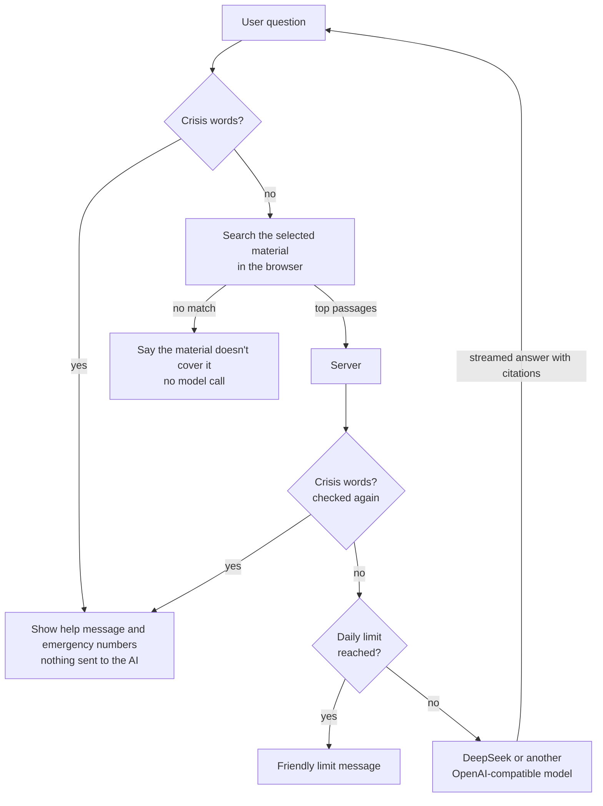

# Unspoken 未言

**A bilingual (Chinese / English) emotional-education web app for parents and teenagers.** Users read short lessons, ask an AI tutor that answers only from the course material and cites its sources, and keep private notes with AI writing help. Messages showing signs of self-harm or abuse are never sent to the AI; the app shows emergency contacts instead.


> **Status: working prototype.** It is not a finished product and not a substitute for counselling or therapy. The seven lessons and the safety text are drafts written with AI from the project notes. They are marked "草稿 · 待审核 / Draft · pending review" in the app and must be reviewed by a qualified professional before real use.

**中文简介：** 未言是一个面向家长和学生的情绪教育网站，支持中文和英文。用户可以阅读课程，向只根据课程资料回答、并标注来源的 AI 提问，还可以在私人笔记本里记录想法、用 AI 帮忙改写。如果用户写下伤害自己或被伤害的内容，这条消息不会发给 AI，而是直接显示求助信息。当前是可运行的原型，课程和安全文案都是草稿，正式使用前需要专业人士审核。

---

## Contents

- [Screenshots](#screenshots)
- [Features](#features)
- [How it works](#how-it-works)
- [Safety and privacy](#safety-and-privacy)
- [Quick start](#quick-start)
- [Configuration](#configuration)
- [Writing content](#writing-content)
- [Sharing a public link](#sharing-a-public-link)
- [API](#api)
- [Project structure](#project-structure)
- [Tests](#tests)
- [Known limits](#known-limits)
- [Credits and licence](#credits-and-licence)

## Screenshots

| Course list (Chinese) | AI writing help in the notebook |
|---|---|
|  |  |

| Crisis message, not sent to the AI | Phone: lessons (Chinese) | Phone: cited answer (English) |
|---|---|---|
|  |  |  |

All screenshots are from the running app; the AI answers are real responses from DeepSeek.

## Features

**Courses**
- Seven short lessons in Chinese and English: what emotional education is, naming feelings, money and guilt, patterns passed down through generations, talking with your child, dating early, and protecting yourself in a relationship.
- On first visit users choose "parent", "student" or "just looking"; lessons for their role are recommended first.
- Progress tracking ("Completed 2 / 7"), a "next lesson" link, and suggested questions at the end of each lesson that ask the AI with one tap.
- Select any passage to save it to the notebook or ask the AI about it.

**Ask Unspoken (grounded Q&A)**
- Answers come only from the chosen material: the courses and platform references, or the user's own uploads.
- Every answer lists its sources as numbered, expandable passages, with matching `[n]` markers in the text.
- If nothing in the material matches, the app says so and does not call the model.
- Recent answered turns are sent along, and a short follow-up that matches nothing on its own ("Why?", "那具体怎么做？") is searched together with the previous question.

**My materials**
- Upload PDF, Word (.docx), TXT or Markdown, up to 15 MB each. Text is extracted in the browser.
- Ask questions about one upload or all of them.

**Notebook**
- Private notes with Markdown preview, search, and export to Markdown (one note or all).
- One-click "save to notes" from AI answers and course passages, with the source attached.
- Six guided templates, such as a feelings log, an argument review, and a letter to your parents or to your child.
- **AI writing help** on the selected text or the whole note: turn into bullet points, say it more gently, or put feelings into words. The result can be inserted or replace the original.

**Languages**
- 中文 / EN switch in the sidebar, phone header and welcome screen, remembered per visitor. The first visit follows the browser language.
- Lessons, templates, safety text, AI answers and AI writing help all follow the chosen language.

**Works on phones**: a bottom tab bar replaces the sidebar, and the chat becomes its own tab. Light and dark mode follow the system setting.

## How it works



1. **Retrieval runs in the browser** (`public/js/retrieval.js`). Text is split into passages (about 400 characters for Chinese, 900 for English), indexed with BM25 over Chinese character bigrams and English words (with stop words and light stemming), and the five best passages are kept. A passage must share at least two meaningful terms with the question (one, if the question has only one).
2. **The server builds the prompt** (`lib/prompt.js`): fixed rules, the user's role and language, the numbered passages, and the question. The rules tell the model to answer only from the passages, cite them, say when the material doesn't cover something, avoid diagnosis and blame, and ignore instructions hidden inside the material.
3. **The server proxies the model** (`server.js`) and streams the reply back. The API key stays on the server.

## Safety and privacy

| Area | How it is handled |
|---|---|
| **Crisis messages** | Questions and AI-writing text are screened for self-harm and abuse terms in the browser *and* on the server. A match shows a fixed help message with emergency numbers and is never sent to the AI. Chinese terms match ignoring spaces and punctuation; English terms match whole words, so "grapes" does not trigger "rape". |
| **Hotlines** | Only numbers marked `"verified": true` in `public/config/safety.json` are shown. Just 110 (police) and 120 (ambulance) are enabled; helpline entries stay hidden until a person verifies the numbers from an official source. |
| **Grounded answers** | The model only sees the selected passages. With no match, no model call is made. |
| **Notes and uploads** | Stored only in the user's browser (IndexedDB). Never uploaded to the server. Clearing browser data deletes them, so users can export. |
| **What reaches the AI** | Only the question, the matching passages, recent answered turns, and text sent to AI writing help. The server does not store any of it. |
| **Cost control** | Daily limits per visitor and for the whole site (defaults: 60 and 1,500), reset at midnight China time. Behind Cloudflare the real visitor address is used. |
| **Browser hardening** | All Markdown is sanitised with DOMPurify. Every response carries a Content-Security-Policy (same-origin scripts only, no framing), `nosniff` and `no-referrer`. Static files cannot be read outside `public/`. |

The crisis message, disclaimer and keyword list are **drafts** and need review by a qualified person. The server reads `safety.json` when it starts, so restart it after editing.

## Quick start

Requires **Node.js 18 or later** (developed and tested on Node 22). There are no runtime dependencies.

```bash
git clone https://github.com/WHYNOT-LUO/unspoken-demo.git
cd unspoken-demo
node server.js
```

Open http://127.0.0.1:3100.

Without an API key the app runs in **test mode**: everything works, but AI replies are clearly labelled placeholders that list the sources found, and no model is called.

To connect a model, copy `.env.example` to `.env`, put your key after `LLM_API_KEY=`, and restart the server:

```bash
cp .env.example .env
```

Any OpenAI-compatible endpoint should work; DeepSeek is the one tested. For mainland China, use a domestic provider:

| Provider | `LLM_BASE_URL` | `LLM_MODEL` |
|---|---|---|
| DeepSeek (default) | `https://api.deepseek.com` | `deepseek-chat` |
| Qwen (Alibaba DashScope) | `https://dashscope.aliyuncs.com/compatible-mode/v1` | `qwen-plus` |

## Configuration

Set these in `.env` (next to `server.js`) or as environment variables. Environment variables win.

| Variable | Default | Meaning |
|---|---|---|
| `LLM_API_KEY` | *(empty)* | Model API key. Empty means test mode. |
| `LLM_BASE_URL` | `https://api.deepseek.com` | OpenAI-compatible base URL; `/chat/completions` is appended. |
| `LLM_MODEL` | `deepseek-chat` | Model name. |
| `LLM_MAX_TOKENS` | `800` | Longest reply, in tokens. |
| `LLM_MOCK` | *(off)* | Set to `1` to force test mode even with a key. |
| `LIMIT_PER_VISITOR_DAY` | `60` | AI requests per visitor per day. |
| `LIMIT_SITE_DAY` | `1500` | AI requests for the whole site per day. |
| `HOST` | `127.0.0.1` | Address to listen on. Use `0.0.0.0` to allow other devices on the network. |
| `PORT` | `3100` | Port. |
| `CONTENT_DIR` | `content` | Folder holding `courses/` and `library/`. |

## Writing content

Lessons are Markdown (`.md`) or plain-text (`.txt`) files. Refresh the page after adding one; no restart is needed.

| Folder | Holds |
|---|---|
| `content/courses/` | Chinese lessons |
| `content/courses/en/` | English lessons, **with the same file names** so progress carries across languages |
| `content/library/` (and `library/en/`) | Platform reference material the AI can also answer from |

If an `en/` folder is missing or empty, English visitors see the Chinese files.

Each file can start with optional front matter:

```markdown
---
title: Giving feelings a name
summary: One line shown on the course card
order: 2
audience: all
questions: How can I tell which emotion I'm feeling? | What can I do when an emotion is very strong?
draft: true
---
Lesson text in Markdown…
```

| Field | Meaning |
|---|---|
| `title` | Lesson title. Defaults to the file name. |
| `summary` | Shown on the course card. |
| `order` | Position in the list (lower first). |
| `audience` | `parent`, `student` or `all` (default). Decides which role sees it as recommended. |
| `questions` | Suggested questions, separated by a vertical bar, shown at the end of the lesson. |
| `draft` | `true` shows the "Draft · pending review" badge and notice. Delete the line once a lesson is approved. |

## Sharing a public link

`start-public-demo.command` starts the server and a free [Cloudflare quick tunnel](https://developers.cloudflare.com/cloudflare-one/connections/connect-networks/do-more-with-tunnels/trycloudflare/), then prints a link like `https://xxxx.trycloudflare.com` that anyone can open. On a Mac, double-click it in Finder.

- It needs `bin/cloudflared`, which is not in the repository. Download `cloudflared-darwin-arm64.tgz` (Apple silicon) from the [cloudflared releases](https://github.com/cloudflare/cloudflared/releases) and unpack it into `bin/`.
- The tunnel uses HTTP/2, which also works behind VPNs and proxies that block QUIC.
- The link works only while that window is open and the computer is awake, and it changes on every run.
- Anyone with the link can use the AI; the daily limits cap the cost.

For a permanent address, run `node server.js` on a server with `HOST=0.0.0.0` behind a reverse proxy with HTTPS. Websites hosted in mainland China generally need an ICP filing; Hong Kong hosting does not.

## API

| Method and path | Purpose |
|---|---|
| `GET /api/status` | `{ "mock": true/false, "model": name or null }` |
| `GET /api/courses?lang=zh` or `?lang=en` | Lessons with id, title, summary, order, audience, questions, draft and text. |
| `GET /api/library?lang=zh` or `?lang=en` | Platform reference documents. |
| `POST /api/chat` | Grounded answer. Body: `question` (up to 1,000 characters), `sources` (1 to 8 items of `{ title, text }`, each text up to 2,000 characters), and optional `history`, `role` (`parent` or `student`) and `lang` (`zh` or `en`). |
| `POST /api/assist` | AI writing help. Body: `task` (`points`, `gentle` or `feelings`), `text` (up to 3,000 characters), and optional `role` and `lang`. |

Both POST endpoints stream the model's reply as server-sent events in the OpenAI `chat.completion.chunk` format, ending with `data: [DONE]`. Other responses are JSON:

| Response | Meaning |
|---|---|
| `200 {"type": "crisis"}` | Crisis language detected; show the help message. Nothing was sent to the model. |
| `400 {"error": "bad_request"}` | Invalid input. |
| `413 {"error": "too_large"}` | Request body over 100 KB. |
| `429 {"error": "limit"}` | Daily limit reached. |
| `502 {"error": "model"}` | The model could not be reached or returned an error. |

## Project structure

```
server.js                 HTTP server: static files, content API, model proxy, limits, security headers
lib/
  config.js               settings from .env and environment variables
  content.js              loads lessons and references (front matter, language folders)
  prompt.js               model instructions for answers and AI writing help
  ratelimit.js            daily per-visitor and site-wide limits
public/                   the web app (plain ES modules, no build step)
  index.html
  css/app.css             layout, light and dark themes, phone layout
  js/app.js               interface
  js/i18n.js              every interface string in Chinese and English
  js/retrieval.js         passage search (shared with the tests)
  js/safety.js            crisis detection (shared by browser and server)
  js/store.js             notes and uploads in IndexedDB
  js/parse.js             text extraction from PDF, Word, TXT and Markdown
  js/templates.js         note templates in both languages
  config/safety.json      crisis message, disclaimer, hotlines, keywords (drafts)
  vendor/                 marked, DOMPurify, mammoth, pdf.js (copied locally, no CDN)
content/
  courses/                Chinese lessons (drafts) and a format guide
  courses/en/             English lessons (drafts)
  library/                platform reference material (empty for now, with a format note)
docs/screenshots/         images used in this README
scripts/vendor.js         re-copies vendor files after npm install
test/                     node:test suites
start-public-demo.command server plus Cloudflare tunnel launcher
.env.example              configuration template
```

Vendor files are committed so the app runs without a CDN, since CDNs are unreliable from mainland China. To update them, run `npm install`, then `npm run vendor`.

## Tests

```bash
npm test
```

65 tests using Node's built-in test runner, with no extra packages:

| Suite | Covers |
|---|---|
| `retrieval.test.js` | Chinese and English tokenising, passage splitting, ranking, unrelated questions, follow-ups |
| `safety.test.js` | Chinese and English crisis detection, false positives, hotline visibility, both languages present |
| `i18n.test.js` | Both languages have the same keys and placeholders; every key used by the page exists |
| `server-lib.test.js` | Front matter, content loading and language fallback, prompt building, rate limits, `.env` parsing |
| `server.test.js` | API in test mode: validation, crisis handling, limits, oversized bodies, path traversal, malformed URLs, security headers |
| `proxy.test.js` | Live mode against a fake model server: request format and API key, streaming, friendly errors that hide upstream details |

## Known limits

- **Keyword search.** Questions worded very differently from the material can miss; embedding search would help.
- **No accounts.** Notes and uploads live in one browser and do not sync between devices.
- **Single server process.** Rate-limit counters are in memory and reset on restart.
- **Unreviewed content.** Lessons, safety text and crisis keywords are drafts.
- **Not built yet:** conversation rehearsal and pattern reflection across notes.

## Credits and licence

Built by [WHYNOT-LUO](https://github.com/WHYNOT-LUO) with AI coding assistance. The app uses [marked](https://github.com/markedjs/marked) (MIT), [DOMPurify](https://github.com/cure53/DOMPurify) (MPL-2.0 or Apache-2.0), [mammoth.js](https://github.com/mwilliamson/mammoth.js) (BSD-2-Clause) and [pdf.js](https://github.com/mozilla/pdf.js) (Apache-2.0).

No licence has been chosen for this project yet.
